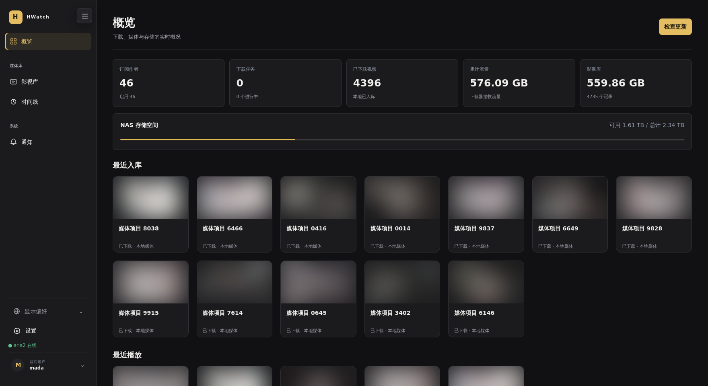

<div align="center">
  <a href="https://github.com/Hwatch/Hwatch-Server"></a>
  <p><em>🗂️ 自托管的 NAS 媒体订阅、下载与 Plex 电视库管理服务 — 基于 Go、SQLite、aria2 与 Vue/TypeScript。</em></p>
  <p><a href="README.md">English</a> · 简体中文</p>
  <div>
    <a href="LICENSE"></a>
    <a href="https://github.com/Hwatch/Hwatch-Server/commits/main"></a>
    <a href="https://github.com/Hwatch/Hwatch-Server"></a>
    <a href="https://github.com/Hwatch/Hwatch-Server"></a>
    <a href="https://github.com/Hwatch/Hwatch-Server/stargazers"></a>
    <a href="https://github.com/Hwatch/Hwatch-Server/issues"></a>
  </div>
</div>

开发文档：[HTTP API V1](API_V1.md) · [OpenAPI 3.1](openapi.yaml) · [开发计划](TODO.md) · [Agent 开发指南](AGENTS.md)

## 界面预览



## 功能

- 创作者页面全分页订阅，首次建立完整基线，后续新作品自动下载
- SQLite 保存订阅、详情元数据、任务、流量和 Plex 季集编号
- aria2 RPC 与系统 wget 下载器，可为新任务切换引擎；已有任务保持原下载器
- 持久下载状态机、暂停/继续、断点续传、429 指数退避、实时速度和连接数
- 可设置全局下载限速、单任务连接数、并发数和下载目录
- 最高画质临时解析，不在数据库长期保存多档下载地址
- HTTP/HTTPS 代理同时应用于采集和 aria2 下载
- 每日定时检查，默认 Asia/Shanghai 04:00
- Plex TV 目录、tvshow.nfo、单集 NFO、海报和单集封面
- 下载完成后通过 ffprobe 记录 H.264/H.265/AV1、音频编码、分辨率、帧率、码率、位深和容器格式
- 项目内影视库浏览、搜索、分页、预览和播放
- 粘贴视频详情 HTML 导入
- NAS 磁盘空间与累计下载流量统计
- 平台适配器注册表；当前来源均通过独立适配器接入
- WebAI 翻译 JSON 安全导出、原文哈希校验和翻译回导
- 首次打开创建管理员账号，后续使用会话 Cookie 与 CSRF 保护
- SQLite 定时备份、SHA-256 校验、恢复后的路径与下载任务协调
- Rule34Video 作者与 Hanime1 作者/播放列表订阅，统一适配器隔离平台差异
- 下载后快速哈希与完整 SHA-256 校验（下载前去重已移除，去重由 TransRunner 主导）
- 单视频删除：仅删除媒体，或删除并加入“已排除”；持久化排除按 `video_id` 阻止后续自动下载，可随时恢复允许下载
- 结构化审计、任务状态历史、持久通知和下载器健康检查
- iPhone Safari 添加到主屏幕所需的 Manifest、图标和安全区域适配

视频计算（去重分析、转码）由独立运行的 TransRunner 服务主导。职责边界：**HWatch 是媒体库权威**（内容获取、下载、订阅、元数据、Plex/NFO、媒体文件最终落库与安全替换、去重/转码结果持久化）；**TransRunner 是计算权威**（批量扫描、H.264→HEVC、VDF 去重、FFmpeg/VideoToolbox、任务队列与进度）。HWatch 不再启动或控制 TransRunner 任务、不轮询进度，也不做下载前去重；它只签发受限、可撤销的 Service Token，供 TransRunner 读取媒体数据并回写结果。详见 [docs/TRANSRUNNER_INTEGRATION.md](docs/TRANSRUNNER_INTEGRATION.md)。

## 平台适配器

统一接口位于 `internal/adapters`。平台实现只负责识别订阅地址、列出视频、读取详情和解析下载源，不直接操作 SQLite、下载器或 Plex。内部视频标识采用 `platform:source_id`；增加新来源不需要修改下载中心和影视库。

目前内置：

- Rule34Video 作者订阅
- Hanime1 用户上传页订阅
- Hanime1 播放列表订阅

平台页面结构可能发生变化。适配器包含快照与契约测试，发现采集异常时不会删除已有媒体。

## WebAI 翻译

在“翻译管理”页面选择目标语言后导出 JSON。导出包只包含平台标识、标题、标签和原文哈希，不包含代理配置、RPC 密钥、Cookie、下载源或文件路径。WebAI 应保留 `key`、`source_hash` 和 `fields`，仅填写 `translations`。回导时原文哈希不一致的条目会被跳过，翻译保存在独立表中，不覆盖原文。

## 一行安装（systemd Linux）

仅适用于**使用 systemd 的 Linux**（Debian/Ubuntu、RHEL/Fedora、Arch、openSUSE）：

```bash
curl -fsSL https://raw.githubusercontent.com/Hwatch/Hwatch-Server/main/install.sh | sudo bash
```

默认安装到 `/opt/hwatch`，创建 `hwatch` systemd 服务并监听 `:8787`，拉取最新 release。可用环境变量配置：`HWATCH_VERSION=v1.0.0`、`HWATCH_DIR`、`HWATCH_PORT`、`HWATCH_MEDIA_ROOT`；参数 `--no-deps`、`--no-service`。

非 systemd 系统（Alpine/OpenRC、Void/runit 等）请加 `--no-service` 并手动运行二进制（见[预编译二进制](#预编译二进制)）。

## 预编译二进制

每次打 `v*` 标签时，GitHub Actions 会为 `amd64` 与 `arm64` 构建静态 Linux 二进制 —— 见 [Releases](https://github.com/Hwatch/Hwatch-Server/releases)。

```bash
tar xzf hwatch-v1.0.0-linux-amd64.tar.gz
cd hwatch-v1.0.0-linux-amd64
sudo install -m755 r34watch /usr/local/bin/r34watch
sudo mkdir -p /opt/hwatch/web && sudo cp -r web/dist /opt/hwatch/web/dist
sudo cp hwatch.service /etc/systemd/system/   # 先按需修改其中路径
sudo systemctl enable --now hwatch
```

二进制通过 `R34WATCH_WEB`（默认 `web/dist`）提供前端，请保持 `r34watch` 与 `web/dist` 在一起（或把 `R34WATCH_WEB` 指向解压目录）。主机需安装 `aria2`、`wget`、`ffmpeg`（含 ffprobe）。

## Docker Compose

先将 compose.yaml 中的 NAS 路径替换为真实 Plex 媒体目录：

    /path/on/nas/Plex-TV:/media

然后运行：

    docker compose up -d --build

访问：

    http://NAS-IP:8787

SQLite 和 aria2 会话位于 data 目录。Plex 将同一个宿主机媒体目录作为电视节目库挂载，
本项目和 Plex 直接查看同一份视频文件，不会复制两份。

## 本机开发

需要 Node.js、Go 1.24、aria2 和 FFmpeg（使用其中的 ffprobe）：

    npm install
    npm run build
    aria2c --enable-rpc=true --rpc-listen-all=false --daemon=true
    go run ./cmd/r34watch

提交前执行：

    go test ./...
    go vet ./...
    npm run build
    go build -o r34watch ./cmd/r34watch
    git diff --check

环境变量：

- R34WATCH_ADDR：监听地址，默认 :8787
- R34WATCH_DB：SQLite 路径，默认 r34watch.db
- R34WATCH_WEB：前端构建目录，默认 web/dist
- R34WATCH_MEDIA_ROOT：下载与 Plex 共用的媒体根目录
- R34WATCH_ARIA_RPC：aria2 JSON-RPC 地址
- R34WATCH_ARIA_SECRET：aria2 RPC 密钥

首次访问网页时必须创建管理员账号。即使已启用登录认证，若需要从公网访问，仍建议放在 HTTPS 反向代理或 VPN 后并限制来源地址。

## API 与客户端

- `/openapi.yaml`：机器可读 OpenAPI 3.1 合约
- `/docs`：服务内置的只读 API 文档入口
- `src/api.generated.ts`：生成的 Vue/TypeScript 类型
- `clients/android-kotlin`：生成的 Android Kotlin 客户端

修改 API 后运行：

    ./scripts/generate-api-clients.sh

## 数据与安全

- 不要提交 SQLite、媒体、aria2 会话、代理凭据、集成令牌或下载签名 URL。
- 媒体与 Plex 共用同一目录，删除或替换媒体前必须确认 NFS 已挂载。
- SQLite 备份可能包含代理和 RPC 配置，应存放在权限受限的目录。
- 任何未来的外部集成 API 的 HTTP 模式只适合可信局域网；跨公网必须使用 HTTPS 或 VPN。

## 项目状态

Frontend 2.0 是本仓库的默认前端。当前仍处于快速开发阶段，未完成事项与长期规划见 [TODO.md](TODO.md)。

## 免责声明

- HWatch 是一个开源的、**自托管**的个人媒体管理工具，本身**不提供、不内置、不镜像、不分发**任何媒体或第三方内容。
- 它仅访问第三方平台以获取元数据和下载链接，用于**你自己**选择的、且有权访问的内容。你需要自行确保使用行为符合当地法律法规及相应平台的服务条款。
- 本项目与任何内容来源或平台**无关联、未获其认可或赞助**。
- **仅限成年人使用**。请勿用它访问、存储或传播在你所在地区属违法、或侵犯版权的内容。
- 软件按**“现状”**提供，不附带任何担保。作者与贡献者不对任何误用、数据丢失或损害负责。
- 不要把实例直接暴露在公网；请使用身份认证、HTTPS 与网络访问限制。

## License

MIT License. 详见 [LICENSE](LICENSE)。
